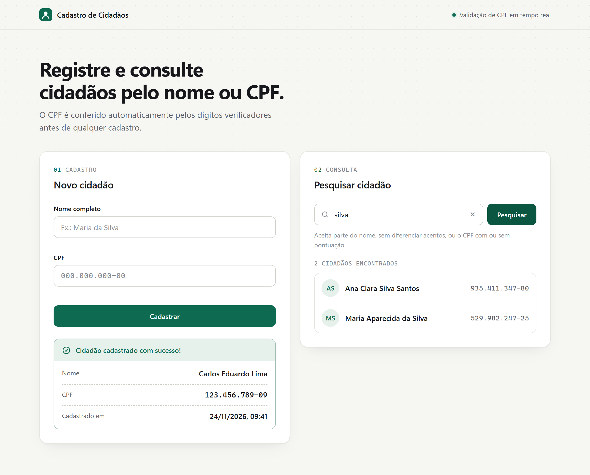

# Cadastro de Cidadãos

Aplicação web para cadastrar cidadãos brasileiros (nome completo e CPF) e pesquisar os registros por nome ou CPF.



- O CPF é validado automaticamente (formato e dígitos verificadores) enquanto é digitado e novamente no servidor.
- Após o cadastro, os dados registrados são exibidos junto de uma mensagem de sucesso.
- A pesquisa aceita nome (ou parte dele, sem diferenciar acentos e maiúsculas) ou CPF (completo ou parcial, com ou sem pontuação). Quando não há resultados, é exibido "Cidadão não encontrado".

O backend foi escrito em Node.js sem nenhum framework: o servidor HTTP, o roteamento e o envio de arquivos estáticos usam apenas os módulos nativos do Node. A interface usa HTML, CSS e JavaScript puros.

## Requisitos

- [Node.js](https://nodejs.org/) 20 ou superior (o npm já vem junto)

## Como executar

```bash
npm install
npm start
```

Depois, acesse **http://localhost:3000**.

O `npm install` instala apenas o ESLint, usado em desenvolvimento. A aplicação em si não tem dependências externas.

### Configuração

| Variável    | Padrão               | Descrição                                                      |
| ----------- | -------------------- | -------------------------------------------------------------- |
| `PORT`      | `3000`               | Porta do servidor HTTP                                         |
| `HOST`      | `localhost`          | Endereço em que o servidor escuta (use `0.0.0.0` em containers) |
| `DATA_FILE` | `data/citizens.json` | Arquivo onde os cadastros são gravados                         |

Exemplo: `PORT=8080 npm start` (no PowerShell: `$env:PORT=8080; npm start`).

## Scripts

| Comando       | Descrição                                        |
| ------------- | ------------------------------------------------ |
| `npm start`   | Inicia a aplicação                               |
| `npm run dev` | Inicia a aplicação reiniciando a cada alteração  |
| `npm test`    | Executa os testes automatizados                  |
| `npm run lint`| Verifica o código com o ESLint                   |

## Testes

Os testes usam o test runner nativo do Node (`node:test`), sem frameworks:

- **Unitários** (`tests/unit`): regras de domínio (validação de CPF e nome, pesquisa) e o serviço de aplicação.
- **Integração** (`tests/integration`): persistência em arquivo (incluindo gravações simultâneas) e a API HTTP de ponta a ponta, com o servidor rodando em uma porta aleatória.

```bash
npm test
```

## API

### `POST /api/citizens`

Cadastra um cidadão.

```json
{ "name": "Maria Oliveira", "cpf": "529.982.247-25" }
```

Resposta `201 Created`:

```json
{
  "message": "Cidadão cadastrado com sucesso!",
  "citizen": { "name": "Maria Oliveira", "cpf": "529.982.247-25", "registeredAt": "2026-03-10T12:30:00.000Z" }
}
```

### `GET /api/citizens?q={nome ou CPF}`

Pesquisa cidadãos. Resposta `200 OK`, com a lista vazia quando ninguém é encontrado:

```json
{ "citizens": [{ "name": "Maria Oliveira", "cpf": "529.982.247-25", "registeredAt": "2026-03-10T12:30:00.000Z" }] }
```

### Erros

Todos os erros seguem o mesmo formato. `field` indica o campo relacionado, quando houver:

```json
{ "error": { "message": "CPF inválido.", "field": "cpf" } }
```

| Status | Situação                                               |
| ------ | ------------------------------------------------------ |
| 400    | JSON malformado                                        |
| 404    | Rota inexistente                                       |
| 405    | Método não suportado pela rota                         |
| 409    | CPF já cadastrado                                      |
| 413    | Corpo da requisição acima de 16 KB                     |
| 415    | Corpo da requisição não está em JSON                   |
| 422    | Dados inválidos (nome, CPF ou termo de pesquisa)       |
| 500    | Erro inesperado (detalhes vão só para o log)           |

## Arquitetura

O código é organizado em camadas, com as dependências sempre apontando para o domínio:

```
src/
├── domain/           Regras de negócio, sem dependência de Node, HTTP ou banco de dados
│   ├── Cpf.js                  Objeto de valor: valida e formata o CPF
│   ├── PersonName.js           Objeto de valor: valida e normaliza o nome completo
│   ├── Citizen.js              Entidade cidadão
│   ├── CitizenSearchQuery.js   Interpreta o termo pesquisado (nome ou CPF) e filtra os resultados
│   ├── CitizenRepository.js    Contrato (classe abstrata) de persistência
│   └── errors.js               Erros de domínio
├── application/
│   └── CitizenService.js       Casos de uso: cadastrar e pesquisar
├── infrastructure/   Implementações do repositório
│   ├── JsonFileCitizenRepository.js
│   ├── InMemoryCitizenRepository.js
│   └── CitizenRecordMapper.js
├── http/             Servidor HTTP construído sobre o módulo node:http
│   ├── HttpApplication.js      Recebe as requisições e despacha para a API ou para os arquivos estáticos
│   ├── Router.js
│   ├── HttpRequest.js          Leitura segura do corpo JSON (limite de tamanho, Content-Type)
│   ├── CitizenController.js
│   ├── ErrorResponder.js       Traduz exceções em respostas HTTP
│   └── StaticFileServer.js
├── app.js            Monta a aplicação HTTP a partir dos serviços
├── config.js         Leitura das variáveis de ambiente
└── server.js         Ponto de entrada: cria as dependências e inicia o servidor

public/               Interface (HTML, CSS e JavaScript em módulos ES)
tests/                Testes unitários e de integração
```

### Padrões e decisões

- **Objetos de valor (`Cpf`, `PersonName`)**: um CPF ou nome só existe se for válido. A validação fica em um único lugar, e o restante do código trabalha com valores já garantidos.
- **Repository**: o serviço depende do contrato `CitizenRepository`, não de uma implementação. Os testes usam a versão em memória e a aplicação usa a versão em arquivo; trocar por um banco de dados exige apenas uma nova implementação.
- **Injeção de dependências**: as dependências são criadas em `server.js` (composition root) e passadas pelo construtor. Isso permite, por exemplo, controlar a data de cadastro nos testes.
- **Mesma regra de validação no cliente e no servidor**: o diretório `src/domain` é publicado em `/domain/` e importado pela interface como módulo ES. A validação em tempo real usa exatamente as mesmas classes e mensagens do servidor, sem duplicar código.
- **CPF como identificador**: o CPF é único por cidadão, então é usado como chave. A unicidade é garantida pelo próprio repositório, como uma restrição de banco de dados, o que evita duplicidade mesmo com requisições simultâneas.
- **Persistência em arquivo JSON**: dispensa instalar e configurar um banco para avaliar o projeto. As gravações são enfileiradas e atômicas (arquivo temporário + renomeação), e o estado em memória só muda depois que a gravação termina com sucesso.
- **Segurança**: limite de tamanho do corpo das requisições, proteção contra *path traversal* nos arquivos estáticos, cabeçalho `X-Content-Type-Options: nosniff`, conteúdo inserido na página via `textContent` (sem `innerHTML`) e erros internos sem detalhes na resposta.

### Regras de validação

- **CPF**: 11 dígitos, com ou sem pontuação (`.`, `-` e espaços); dígitos verificadores corretos; sequências repetidas como `111.111.111-11` são recusadas.
- **Nome completo**: ao menos nome e sobrenome, apenas letras (com acentos), apóstrofos e hífens, até 120 caracteres. Espaços extras são removidos.

## Limitações e próximos passos para produção

O escopo segue o que o desafio pede: qualquer pessoa com acesso à aplicação pode cadastrar e consultar, e a pesquisa exibe nome e CPF completos. Como CPF é dado pessoal protegido pela LGPD, um uso real exigiria:

- **Autenticação e controle de acesso**: apenas usuários autorizados cadastram e consultam, com perfis diferentes para cada operação.
- **Mascaramento do CPF** (ex.: `***.982.247-**`) para perfis que não precisam do número completo.
- **Limite de requisições na pesquisa e no cadastro**, para impedir a varredura de CPFs. Hoje tanto a busca quanto o aviso de CPF já cadastrado revelam se um CPF existe na base, o que é esperado pelo requisito, mas precisa de proteção contra abuso.
- **Registro de auditoria** de quem consultou ou cadastrou cada cidadão.
- **Banco de dados** no lugar do arquivo JSON, mantendo a unicidade do CPF como restrição do banco. Basta uma nova implementação de `CitizenRepository`.
- **HTTPS**, normalmente fornecido por um proxy reverso na frente da aplicação.
